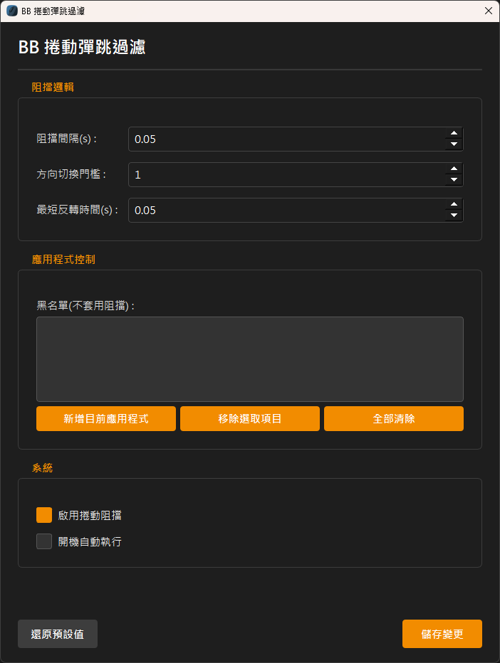

# BB 捲動彈跳過濾

一款輕巧實用的 Windows 工具, 可減少滑鼠滾輪意外捲動與抖動問題

MeteAvci/WheelScrollFixer 的BB修改版本  
基本上就是移除了BB用不到的功能+中文化  

### MeteAvci/WheelScrollFixer

- https://github.com/MeteAvci/WheelScrollFixer

### 保留的功能

- 滑鼠滾輪方向反轉過濾
- 可調整阻擋間隔, 方向切換門檻, 最短反轉時間
- 應用程式黑名單
- 從系統匣啟用或停用阻擋功能, 開啟設定, 說明, 關於視窗
- 開機啟動及監看程序, 程式意外結束時可由監看程序重新啟動
- JSON 設定儲存, 還原預設值, 單一執行個體限制

### 移除的功能

- 校正精靈 (Calibration Wizard)
- 個別應用程式設定檔, 此版本的阻擋參數為全域設定, 黑名單僅用來排除特定程式
- 嚴格模式 (Strict Mode)
- 智慧動量 (Smart Momentum)

### 新增的功能

- 中文化

### 截圖



# 下載

### 到 Releases 下載最新版

- [BB Wheel Scroll Fixer.exe](https://github.com/BeefBB/bb-wheel-scroll-fixer/releases)

然後放到一個你不會移動的地方, 再執行它  

## 備註

如果開機啟動失效了, 那通常是因為你移動了這個程式,  
請重新執行一次並再次選擇 開機自動執行  

# 想自己編譯?

## 執行

```bash
py -m venv .venv
.\.venv\Scripts\Activate.ps1
pip install -r requirements.txt
```

```bash
pyinstaller --noconfirm --onefile --noconsole --icon=mouse.ico --name="BB Wheel Scroll Fixer" --add-data "mouse.ico;."  "bb-wheel-scroll-fixer.py"
```

打包後會在 `./dist`  

# 重要事項

- 需要系統管理員權限: 本程式需要安裝低階滑鼠掛鉤, 因此必須以系統管理員權限執行
- 防毒軟體警告: 由於本程式使用低階滑鼠掛鉤, 部分防毒軟體可能會將其判定為潛在威脅

# 命令列參數

- `--no-watchdog`: 不啟動監看程序, 此參數適合開發與除錯, 可避免程式結束後被監看程序重新啟動

# 致謝

部分程式碼最初基於以下項目:  

- [MeteAvci/WheelScrollFixer (MIT license)](https://github.com/MeteAvci/WheelScrollFixer)

第三方授權文件請見 `THIRD_PARTY_LICENSES/` .

# 版權

MIT License  